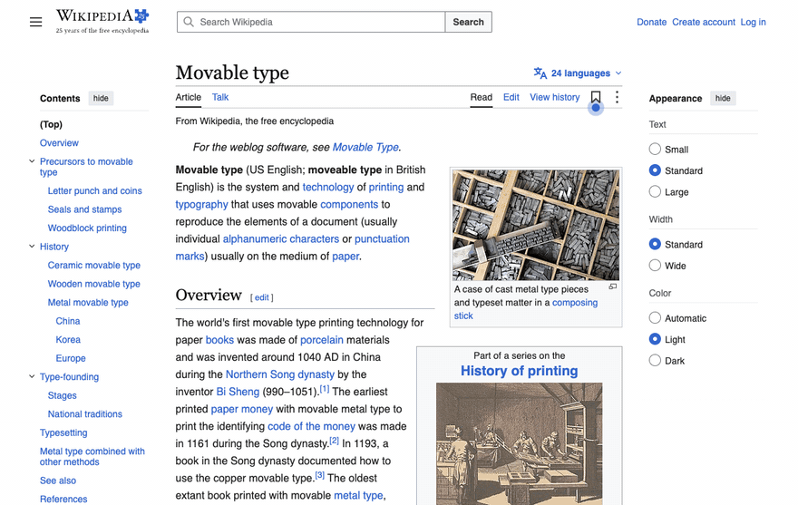
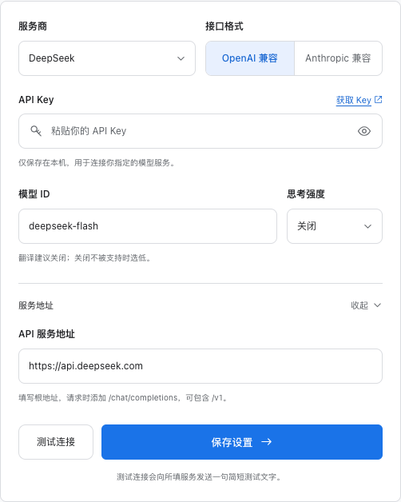

<div align="center">


# 原页 · Pagelet

**使用 LLM API 的网页翻译扩展**

[](https://github.com/YiTaiiiiii/pagelet-translate/releases/latest)
[](https://github.com/YiTaiiiiii/pagelet-translate/actions/workflows/ci.yml)
[](https://github.com/YiTaiiiiii/pagelet-translate/releases)
[](LICENSE)
[](https://github.com/YiTaiiiiii/pagelet-translate/stargazers)

[下载](https://github.com/YiTaiiiiii/pagelet-translate/releases/latest) · [安装](#安装) · [配置](#配置) · [English](#english)



</div>

## 功能

- 双语对照或只看译文，再按一次恢复原文
- 插入译文时阅读位置不跳
- 按滚动方向提前翻译，已是目标语言的段落跳过
- 单段查看原文、重译、失败重试
- 总是翻译某个网站
- 快捷键 Alt+T（macOS 为 ⌥T）

## 安装

1. 在 [Releases](https://github.com/YiTaiiiiii/pagelet-translate/releases/latest) 下载 `pagelet-<版本>-chrome.zip` 并解压。
2. 打开 `chrome://extensions`，开启右上角“开发者模式”。
3. 点“加载已解压的扩展程序”，选择解压出的文件夹。

## 配置

在扩展设置页填 API Key，点“测试连接”，再保存。之后在网页上点工具栏图标，或按 Alt+T。

推荐 DeepSeek `deepseek-flash`，思考强度“关闭”，也是默认设置。其他 OpenAI 兼容或 Anthropic 兼容的服务也能用，在服务商列表里选或自定义地址。

<p align="center"></p>

## 开发

```sh
pnpm install
pnpm dev                                # 开发模式
pnpm build && pnpm test                 # 构建并测试
pnpm test:upgrade                       # 升级测试
pnpm zip                                # 打包
```

## Star History

<a href="https://star-history.com/#YiTaiiiiii/pagelet-translate&Date">
  <picture>
    <source media="(prefers-color-scheme: dark)" srcset="https://api.star-history.com/svg?repos=yitaiiiiii/pagelet-translate&type=Date&theme=dark">
    
  </picture>
</a>

## 许可

[MIT](LICENSE)

---

## English

A web page translation extension that uses an LLM API.

**Install**: download `pagelet-<version>-chrome.zip` from [Releases](https://github.com/YiTaiiiiii/pagelet-translate/releases/latest), unzip it, open `chrome://extensions`, enable Developer mode, then "Load unpacked".

**Configure**: enter your API key in the options page, test the connection and save. Recommended: DeepSeek `deepseek-flash` with thinking off (the default). Other OpenAI- or Anthropic-compatible services work too.

**License**: [MIT](LICENSE)
